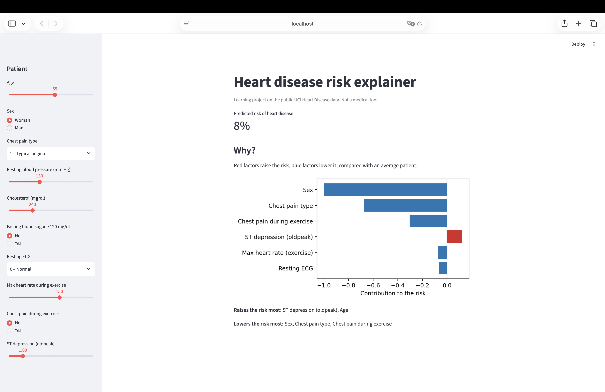
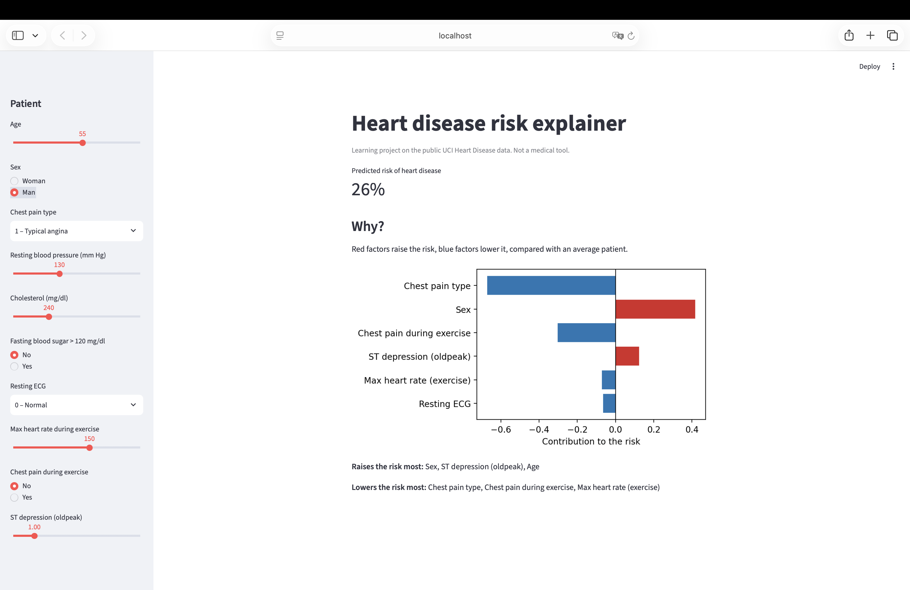

# Heart Disease Risk Prediction with Fairness Audit and Explainable AI


An end-to-end machine learning project: from raw clinical data to a validated model, a **fairness audit across patient groups**, **per-patient explanations**, and an **interactive web app**.

**Data:** UCI Heart Disease, 564 patients from two hospitals (Cleveland, Hungary)
**Model:** Logistic regression, **AUC 0.88**, accuracy 0.79 (5-fold stratified cross-validation)

---

## Demo

The app predicts a patient's risk of heart disease and explains which factors drive it.
Here, the **same patient** is entered twice, changing only sex:

| Woman: 8% risk | Man: 26% risk |
|---|---|
|  |  |

---

## Key results

**1. The model performs well overall:** AUC 0.88, accuracy 0.79.

**2. But it misses more sick women than sick men.**

| Group | Sick patients detected (sensitivity) | Accuracy |
|---|---|---|
| Men | 76% (152 / 200) | 77% |
| Women | **57% (21 / 37)** | **85%** |

Accuracy is *higher* for women, which hides the problem: most women in the data are healthy.
Group-level sensitivity reveals it.

**3. Explainability shows why:** sex is one of the model's strongest predictors (odds ×4.1 for men, all else equal).

**4. Mitigation:** I compared three strategies.

| Strategy | Sick women detected | Sick men detected | Accuracy |
|---|---|---|---|
| Baseline | 21 / 37 | 152 / 200 | 0.794 |
| **Remove sex feature** | **27 / 37** | 142 / 200 | 0.794 |
| Lower threshold for all (0.4) | 26 / 37 | 162 / 200 | 0.789 |
| Lower threshold for women (0.35) | 26 / 37 | 152 / 200 | 0.794 |

Removing sex closed the gap with no loss in accuracy, by redistributing errors between groups.
Each strategy involves a trade-off, which I document rather than hide.

---

## What this project demonstrates

- **Data preparation:** merging sources, handling missing values, feature selection
- **Modelling:** scikit-learn pipelines (scaling, one-hot encoding, logistic regression)
- **Evaluation:** stratified cross-validation, ROC-AUC, confusion matrix, sensitivity / specificity
- **Fairness auditing:** subgroup metrics with confidence intervals, bias mitigation and trade-off analysis
- **Explainable AI:** global coefficients and per-patient feature contributions (SHAP-equivalent for linear models)
- **Deployment:** interactive Streamlit app
- **Responsible AI:** clear reporting of limitations and uncertainty

---

## Project structure

```
heart-disease-fair-ai/
├── notebooks/
│   ├── 01_data.ipynb            # cleaning, merging, group analysis
│   ├── 02_model.ipynb           # pipeline, cross-validation, metrics
│   ├── 03_fairness.ipynb        # performance by sex, age, hospital
│   ├── 04_explain.ipynb         # global and per-patient explanations
│   └── 05_fairer_model.ipynb    # bias mitigation experiments
├── src/explain.py               # explanation logic (shared by notebooks and app)
├── app/app.py                   # Streamlit app
├── data/README.md               # how to download the data
└── requirements.txt
```

## Quickstart

```bash
pip install -r requirements.txt
# download the data into data/ (see data/README.md)
# run the notebooks in order, then:
streamlit run app/app.py
```

## Limitations

Small number of sick women (37), so the size of the gap is uncertain (95% CI: 2 to 36 points).
Data from the 1980s, from two hospitals and from patients referred for angiography.
Not a medical tool.

---

**Author:** Fatemeh Karimi Khouigani, MSc Human-Centered AI, University of Milan

*Data: Janosi, Steinbrunn, Pfisterer & Detrano (1988), UCI Machine Learning Repository, CC BY 4.0.*
